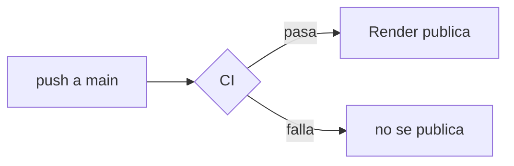

<div align="center">

<picture>
  <source media="(prefers-color-scheme: dark)" srcset="public/img/go503-logo-oscuro.svg">
  
</picture>

# go503

**¿Ya viene el bus?** Mapa en vivo de los buses de San Salvador y panel para dueños de flotas.

[](https://github.com/Elpiratilla/bus-tracker/actions/workflows/ci.yml)


[Qué hace](#qué-hace) · [Empezar](#empezar) · [Estructura](#estructura) · [Variables](#variables-de-entorno) · [Publicar](#publicar) · [Legal](#legal)

</div>

---

## Qué hace

| | Para quién | Qué ve |
| :---: | --- | --- |
| 🗺️ | **Pasajeros** | Por dónde va el bus de su ruta y cuántos minutos le faltan para llegar a su parada. Sin cuenta. |
| 🔔 | **Pasajeros** | Un aviso en el celular cuando el bus está por llegar. |
| 📊 | **Dueños de flotas** | Ubicación, historial, datos del motor, mantenimiento y tiempos por tramo de cada unidad. |
| 📱 | **Motoristas** | Una app Android que convierte su celular en el GPS del bus mientras dura el trayecto. |
| 🏫 | **Familias** | Un enlace privado para ver dónde va el microbús escolar. |

Los datos llegan de un **sensor ESP32** (GPS + 4G + motor) instalado en cada bus, o de la app del motorista.

> [!NOTE]
> Por ahora solo están cargadas las rutas **101, 42 y 29**. Las demás rutas de San Salvador llegan en la etapa 4.

## Empezar

Necesitas Node 22 y un archivo `.env` con las claves de la sección [Variables de entorno](#variables-de-entorno).

```bash
npm install
npm run dev
```

Abre <http://localhost:3000>. Sin `SUPABASE_URL`, el servidor trabaja solo en memoria.

| Comando | Qué hace |
| --- | --- |
| `npm run dev` | Servidor que se reinicia solo al guardar cambios |
| `npm start` | Servidor normal, el mismo que usa Render |
| `npm test` | Pruebas de `test/` |
| `npm run simulate` | Buses de prueba que recorren las rutas, para ver el mapa sin sensores (con el servidor encendido) |
| `npm run admin` | Crea la cuenta de administrador, o vuelve administradora una cuenta existente |
| `npm run codigo -- "Empresa"` | Genera un código de invitación para que una empresa se registre |

## Estructura

```text
bus-tracker/
├── src/               servidor Express: API, cálculo de llegadas, avisos
│   └── routes/        una ruta de la API por archivo
├── public/
│   ├── html/          las páginas (se abren en la raíz: /mapa.html, /legal.html…)
│   ├── css/  js/      estilos y código de las páginas
│   └── img/  fonts/   logos, íconos y letras
├── app/               app Android del motorista (Capacitor)
├── firmware/          programa del sensor ESP32
├── supabase/          migraciones de la base de datos
├── test/              pruebas
└── tools/             simulador, cuenta admin y códigos
```

<details>
<summary><b>Las páginas</b></summary>

| Página | Para qué |
| --- | --- |
| `index.html` | Portada y formulario «Pedir el sensor» |
| `mapa.html` | Mapa en vivo, paradas cerca y avisos |
| `sensor.html` | Cómo funciona el sensor |
| `preguntas.html` | Preguntas de los dueños |
| `login.html` | Entrar o registrar una empresa (con código de invitación) |
| `panel.html` | Panel de la flota |
| `motorista.html` | App del motorista |
| `legal.html` | Legal y privacidad |

</details>

## Variables de entorno

Van en `.env` para trabajar en tu computadora y en **Environment** de Render cuando publicas. Nunca se suben a GitHub.

| Variable | Para qué | ¿Obligatoria? |
| --- | --- | :---: |
| `SUPABASE_URL` | Dirección del proyecto de Supabase | Sí |
| `SUPABASE_SECRET_KEY` | Clave secreta: solo la usa el servidor | Sí |
| `SUPABASE_PUBLISHABLE_KEY` | Clave pública que usa el navegador para iniciar sesión | Sí |
| `BUS_API_KEY` | Clave de los sensores. Sin ella, el servidor no arranca en producción | En producción |
| `VAPID_PUBLIC_KEY` · `VAPID_PRIVATE_KEY` · `VAPID_SUBJECT` | Avisos al celular (Web Push) | Para los avisos |
| `PORT` | Puerto del servidor (3000 si no se pone) | No |

## Publicar

Cada push a `main` pasa por el [CI](.github/workflows/ci.yml): revisa la sintaxis, corre las pruebas y arranca el servidor para comprobar que responda. **Render publica solo si el CI pasa** ([`render.yaml`](render.yaml)).



## Legal

Los textos que ve el público están en [`public/html/legal.html`](public/html/legal.html), enlazada en el pie de página como «Legal y privacidad». Este README no la sustituye: los usuarios no lo ven, y la ley pide que esa información esté a la vista en el sitio.

<details>
<summary><b>Qué incluye la página</b></summary>

1. Quiénes somos (aviso legal)
2. Términos de uso
3. Privacidad
4. Cookies y lo que se guarda en el navegador
5. Propiedad intelectual
6. Venta del sensor
7. Reportar un problema
8. Reclamos y contacto

</details>

### Falta completar antes de publicar

> [!IMPORTANT]
> Todo lo que falta aparece en `legal.html` marcado en amarillo (`<mark class="falta">`). Para encontrarlo:
>
> ```bash
> grep -n 'class="falta"' public/html/legal.html
> ```

- [ ] Nombre legal o razón social del responsable, NIT, NRC (si aplica) y representante legal (si es una sociedad)
- [ ] Dirección para notificaciones, correo y WhatsApp de contacto
- [ ] Titular de los derechos sobre el nombre, el logo y el código
- [ ] Plazo para borrar solicitudes de venta sin compra (propuesta: 24 meses), y borrarlas de verdad en la tabla `leads`
- [ ] Plazo para responder reclamos (propuesta: 10 días hábiles)
- [ ] Revisar si hay que inscribirse como proveedor ante la Defensoría del Consumidor
- [ ] Que un abogado salvadoreño revise los textos antes de vender el primer sensor

<details>
<summary><b>Dónde se cumple en el código</b></summary>

| Qué | Dónde |
| --- | --- |
| Enlace en el pie de todas las páginas públicas | `index.html`, `sensor.html`, `preguntas.html`, `legal.html` |
| Aviso de privacidad en el formulario de pedido | `index.html` (`.order__legal`) |
| Casilla obligatoria y sin marcar al crear una cuenta de empresa | `login.html` (`#c-acepto`) y `public/js/acceso.js` |
| Constancia de la aceptación (versión y fecha) | `acceso.js` la guarda en los datos del usuario de Supabase (`terminos_version`, `terminos_aceptados`) |
| Aviso de ubicación en la app del motorista | `motorista.html` |
| Plazos de borrado que promete la página | `src/db.js` (historial 7 días, vueltas 30 días) y `src/alerts.js` (avisos 3 horas) |

</details>

### Cuando algo cambie

La página tiene que decir lo que la app hace de verdad. Si agregas un formulario o un proveedor nuevo (por ejemplo, analítica), si cambias un plazo de borrado o si empiezas a cobrar en línea:

1. Actualiza la sección que corresponde en `legal.html`.
2. Cambia la versión y la fecha en `legal.html` y `TERMINOS_VERSION` en `public/js/acceso.js`.
3. Si el cambio es importante, avisa a las empresas por correo con 15 días de anticipación, como prometen los términos (2.9).
4. Si agregas analítica o cookies que no son necesarias, primero hace falta un aviso que pida permiso.

<sub>Leyes que se citan: Ley para la Protección de Datos Personales (Decreto Legislativo n.º 144, 2024) y Ley de Protección al Consumidor (artículos 13-D, 21-A y 21-B, sobre comercio electrónico).</sub>

---

<div align="center"><sub>Hecho en El Salvador por gente que también espera el bus.</sub></div>
